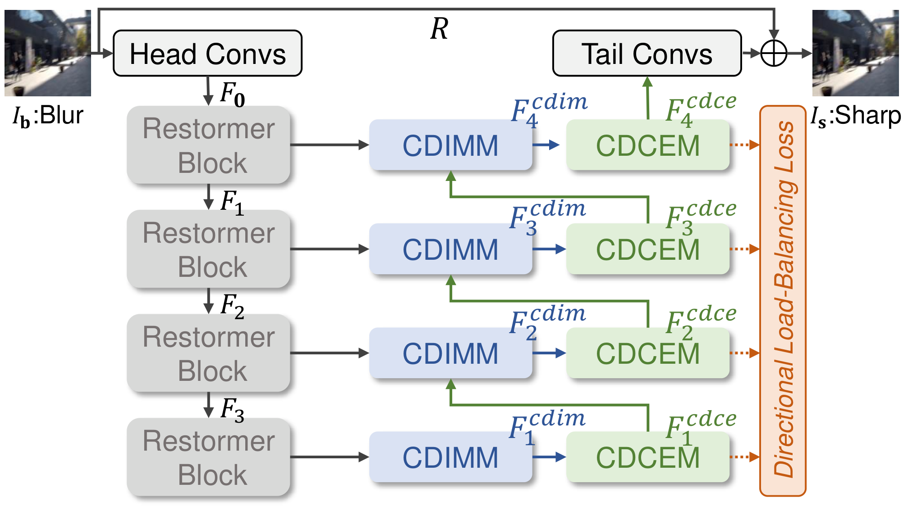

# CDIMamba

**Learning Blur Directional Bias with Cross-Directional Interactive Mamba for Image Deblurring**


Reference implementation built on the [BasicSR](https://github.com/XPixelGroup/BasicSR) framework.



---


## Project Layout

```
CDIMamba/
├── models/
│   ├── arch/
│   │   ├── ss2d.py                  # SelectiveScan2D: dependency-free 2D selective scan
│   │   ├── cdimm.py                 # CDIMM: 4-direction split -> SS2D -> directional expert gate
│   │   ├── cdcem.py                 # CDCEM: external spatial experts + DWConv pooling gate
│   │   ├── restormer_blocks.py      # MDTA + GDFN backbone blocks, Downsample/Upsample
│   │   └── cdimmaba.py              # top-level network, shared expert bank, gating accessor
│   ├── data/
│   │   └── paired_deblur_dataset.py # GoPro / HIDE / RealBlur paired dataset
│   ├── losses/
│   │   └── directional_load_balancing.py   # Eq. (7) + entropy diagnostic
│   └── cdimmaba_model.py            # SRModel subclass: L_total = L_rec + lambda * L_DLB
├── options/
│   ├── train/CDIMamba_GoPro.yml
│   ├── train/CDIMamba_GoPro_Ablation.yml
│   └── test/CDIMamba_GoPro.yml
├── train.py                         # wraps basicsr.train.train_pipeline
├── inference_cdimmaba.py            # single-image / folder inference with tiled mode
└── requirements.txt
```

---

## Install

BasicSR is used as a **real external dependency** — nothing in `site-packages`
is patched. The local `models` package registers the architectures into the
official registries on import.

```bash
# torch matching basicsr 1.4.2's pin (torchvision < 0.17)
pip install torch==2.5.0 torchvision==0.20.0 --index-url https://download.pytorch.org/whl/cu121
pip install -r requirements.txt
python setup.py develop     # or: pip install -e .
```
---

## 5. Training

```bash
python train.py -opt options/train/CDIMamba_GoPro.yml

# override data paths without editing the yml
python train.py -opt options/train/CDIMamba_GoPro.yml \
    --force_yml dataroot_gt=/data/GoPro/train/sharp \
                dataroot_lq=/data/GoPro/train/blur

# 4-GPU distributed
python -m torch.distributed.launch --nproc_per_node=4 --master_port=4321 \
    train.py -opt options/train/CDIMamba_GoPro.yml --launcher pytorch
```

Expected data layout:

```
datasets/GoPro/train/blur/*.png
datasets/GoPro/train/sharp/*.png
datasets/GoPro/test/blur/*.png
datasets/GoPro/test/sharp/*.png
```

Key hyper-parameters from the paper: `dim=48`, `num_blocks=[4,6,6]`,
`num_heads=[1,2,4]`, `m=4` scan directions, `n=4` experts, `k=2` TopK,
`d_state=16`, AdamW `lr=2e-4`, `wd=1e-4`, batch 8, `gt_size=256`, EMA 0.999,
`lambda=0.01` for L_DLB.

---

## 6. Evaluation & inference

```bash
python basicsr/test.py -opt options/test/CDIMamba_GoPro.yml

python inference_cdimmaba.py \
    --checkpoint experiments/CDIMamba_GoPro/models/net_g_latest.pth \
    --input datasets/GoPro/test/blur \
    --output results/deblur
```

---
